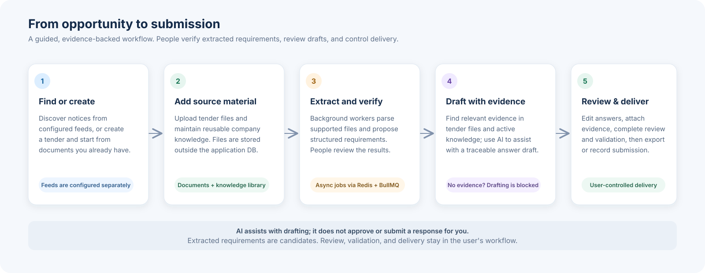
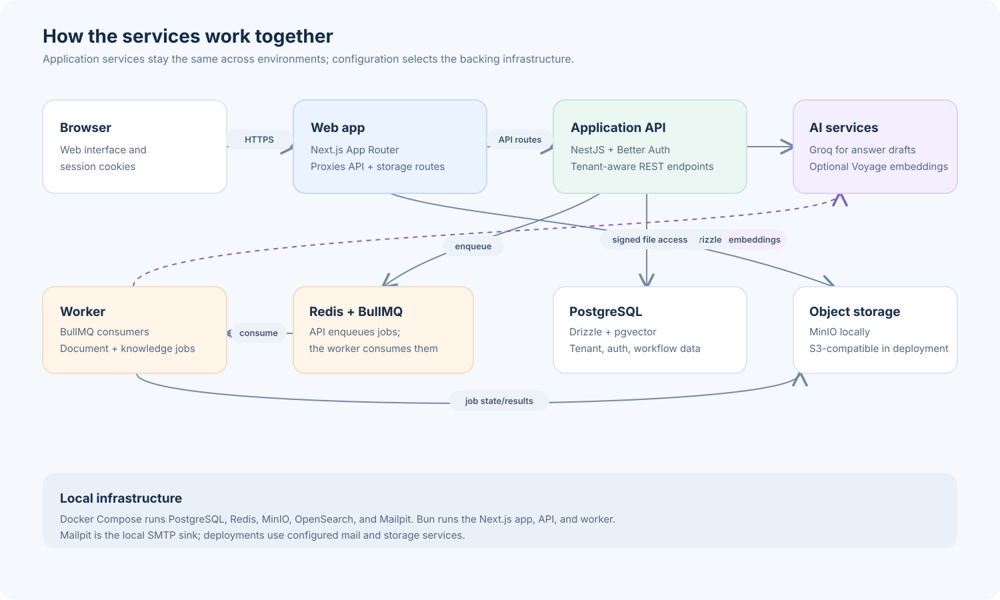

# TENDYY

TENDYY is a multi-tenant workspace for discovering tenders and managing
responses. The application brings tender discovery, document processing,
requirements, reusable knowledge, AI-assisted answers, evidence, reviews, and
submission workflows together in one place.

The active product domain is `tenders`: a tender is both a discovery
opportunity and the workspace for its application, answers, evidence, reviews,
and validation. Environment configuration selects the infrastructure used in
local, staging, and production environments.

## Capabilities

- Discover, filter, compare, save, and track tender opportunities.
- Manage tender workspaces, requirements, questions, answers, evidence, and
  reviews.
- Process documents and retrieve reusable knowledge for response authoring.
- Use Groq-backed AI assistance for answer drafts; configure verified
  discovery feeds separately. Discovery portals remain disabled until
  configured.
- Manage organizations, workspaces, memberships, roles, and permissions.

## How a tender moves through TENDYY



1. **Find or create the opportunity.** Discover notices from configured tender
   feeds, or create a tender from work already in progress. Feeds are not
   enabled until verified and configured.
2. **Bring in the source material.** Upload tender documents and maintain
   reusable company knowledge. The database stores document metadata while
   MinIO or configured S3-compatible storage holds the file contents.
3. **Extract and organize.** The API queues document work in Redis with BullMQ.
   Workers parse supported files and create structured requirement candidates.
   People review the extracted information before using it in a response.
4. **Draft from evidence.** TENDYY retrieves relevant material from the tender
   documents and active knowledge sources. AI can help draft an answer from
   that evidence; when evidence is missing, generation is blocked rather than
   inventing a supported response. Drafts remain editable and reviewable.
5. **Review and deliver.** Teams attach and verify evidence, complete reviews
   and validation, then export a response or record its submission. TENDYY
   does not approve or submit responses on a user's behalf.

This process is scoped to an organization and its workspaces. Memberships and
permissions are resolved by the API, including for background work.

## Runtime architecture



- **Web app:** Next.js provides the browser interface and proxies API and
  storage routes.
- **API:** NestJS handles authentication, organization and workspace access,
  validation, tender workflows, and background-job scheduling.
- **Worker:** BullMQ consumers process document and knowledge jobs outside the
  request/response cycle.
- **Data and files:** PostgreSQL stores application and identity data;
  pgvector supports knowledge embeddings. MinIO is used locally, with
  S3-compatible storage available for deployment.
- **AI and email:** Groq provides answer-generation calls; Voyage embeddings
  are optional. Without an embedding key, knowledge retrieval falls back to
  keyword search. Local email goes to Mailpit; deployments use configured
  SMTP.

## Stack

- Bun, TypeScript, Turborepo
- Next.js App Router frontend in `apps/web`
- NestJS REST API in `apps/api`
- BullMQ worker in `apps/worker`
- PostgreSQL + pgvector with Drizzle in `packages/db`
- Redis for queues, MinIO/S3-compatible storage, and OpenSearch in the local
  infrastructure
- Better Auth browser sessions backed by Postgres
- `apps/mcp` is a standalone MCP server scaffold that currently exposes a
  `ping` tool; `apps/extension` is a browser extension scaffold. Neither is
  required to run the web app, API, or worker.

## Local Setup

Requirements: Bun (see the `engines` field in `package.json`) and Docker
Engine with the Docker Compose v2 plugin.

```bash
bun install
test -f .env.local || cp .env.example .env.local
bun dev
```

On Windows PowerShell, copy the example with:

```powershell
if (-not (Test-Path .env.local)) { Copy-Item .env.example .env.local }
```

The root scripts load defaults from `.env.example`, then override them with
`.env`, `.env.local`, and the current process environment, in that order.
`bun dev` starts local infrastructure, applies database migrations, ensures
the local demo seed data exists, and starts the API, worker, and web app in
watch mode. The demo login is for local development only.

Local URLs:

- Web: `http://localhost:3000`
- API: `http://localhost:4100`
- Mailpit SMTP: `localhost:51025`
- Mailpit email UI: `http://localhost:58025`
- MinIO API: `http://localhost:59000`
- MinIO Console: `http://localhost:59001`
- OpenSearch: `http://localhost:45200`

PostgreSQL and Redis are also exposed on `localhost:55432` and
`localhost:56379`, respectively.

## Commands

```bash
bun dev              # infra + migrate + seed + hot-reload API/worker/web
bun dev:apps         # hot-reload API/worker/web only

bun infra:up         # start PostgreSQL, Redis, MinIO, OpenSearch, Mailpit
bun infra:down       # stop local infrastructure
bun infra:logs       # follow local infrastructure logs
bun infra:reset      # local-only: destroy volumes and recreate infra

bun db:migrate       # apply Drizzle migrations
bun db:ensure-seed   # seed only when demo data is missing
bun db:seed          # explicitly seed development data
bun db:reset         # local-only: drop/recreate DB schema and rerun migrations

bun doctor           # verify local tooling, infra, env, DB, and seed data
bun build            # production build
bun test             # fast unit tests, no database
bun test:db          # DB-backed API/worker tests; requires infra + migrations
bun test:e2e         # Playwright specs through the web package runner
bun lint             # lint
bun typecheck        # TypeScript checks
bun format           # format files with Prettier
```

`db:reset` and `infra:reset` refuse to run unless `APP_ENV=local`.
`bun test:db` requires a reachable PostgreSQL database; use the local
infrastructure, migrations, and seed setup first.

## Environment Model

Do not edit source code when moving between local, staging, and production.
Change only environment values.

| Configuration | Local                                     | Staging                        | Production                        |
| ------------- | ----------------------------------------- | ------------------------------ | --------------------------------- |
| Web           | `localhost:3000`                          | staging URL                    | production URL                    |
| API           | `localhost:4100`                          | staging API/internal URL       | production API/internal URL       |
| PostgreSQL    | Docker `localhost:55432`                  | staging DB                     | production DB                     |
| Redis         | Docker `localhost:56379`                  | staging Redis                  | production Redis                  |
| Storage       | MinIO `localhost:59000`                   | staging S3/MinIO               | production S3/MinIO               |
| Search        | OpenSearch `localhost:45200`              | staging search                 | production search                 |
| Mail          | Mailpit `localhost:51025`                 | configured SMTP                | configured SMTP                   |
| AI            | `AI_PROVIDER=mock` or configured provider | configured provider            | configured provider; never mock   |
| Auth          | Better Auth + local Postgres              | Better Auth + staging Postgres | Better Auth + production Postgres |

Important variables:

- `APP_ENV=local|staging|production`
- `NEXT_PUBLIC_APP_URL`
- `NEXT_PUBLIC_API_URL`
- `API_INTERNAL_URL`
- `TENDER_DISCOVERY_FEEDS_JSON` for verified tender discovery feeds
- `DATABASE_URL`
- `REDIS_URL`
- `STORAGE_ENDPOINT`
- `STORAGE_PUBLIC_ENDPOINT`
- `STORAGE_BUCKET`
- `OPENSEARCH_URL`
- `CORS_ORIGIN`
- `AI_PROVIDER`
- `BETTER_AUTH_SECRET`
- `BETTER_AUTH_URL`
- `BETTER_AUTH_GOOGLE_CLIENT_ID`
- `BETTER_AUTH_GOOGLE_CLIENT_SECRET`
- `SMTP_HOST`, `SMTP_PORT`, and related SMTP settings
- `GROQ_API_KEY` when using Groq; `VOYAGE_API_KEY` is optional for embeddings

`.env.local`, `.env`, `.env.production`, and other real env files are ignored.
Only example files are intended to be committed. Keep real credentials out of
the example files and source control.

## Local Infrastructure

`docker-compose.yml` runs the local dependencies:

- PostgreSQL with pgvector on host port `55432`
- Redis on host port `56379`
- MinIO on host ports `59000` and `59001`
- OpenSearch on host port `45200`
- Mailpit on host ports `51025` (SMTP) and `58025` (web UI)

The MinIO bucket is initialized automatically from `MINIO_DEFAULT_BUCKETS`.

Application code runs directly on the host for fast hot reload:

```text
Host:   Next.js, NestJS API, Worker
Docker: PostgreSQL, Redis, MinIO, OpenSearch, Mailpit
```

## Health Checks

- `GET /health` and `GET /api/v1/health` report API liveness.
- `GET /ready` checks readiness and returns HTTP 503 if a required dependency
  is unavailable.
- `GET /health/dependencies` reports dependency status, including database,
  Redis, storage, OpenSearch, and mail.

## Production Build

Run locally before deployment:

```bash
bun typecheck
bun lint
bun build
```

Production must provide environment variables through the deployment platform.
There should be no step that changes localhost URLs or source files before
deployment.

Local Windows development sets `NEXT_OUTPUT_STANDALONE=false` in `.env.local`
to avoid standalone trace symlink permission issues. Staging and production can
omit it and keep Next's standalone output enabled.

## Deployment

Dokploy is the supported production deployment target. The single
`docker-compose.yml` uses profiles:

- `local`: local PostgreSQL, Redis, MinIO, OpenSearch, and Mailpit.
- `dokploy-bundled`: app containers plus bundled PostgreSQL, Redis, and MinIO.

Use `COMPOSE_PROFILES=dokploy-bundled` in Dokploy. See `DEPLOY.md` for the
full environment contract and the backup/restore flow for migrating data from a
separate Dokploy Postgres service.

## Authentication

Better Auth provides browser sessions backed by the Postgres/Drizzle identity
tables. The API resolves tenant access from server-side memberships and
permissions.

## Domain model

`tenders` is the canonical active product domain. Legacy `rfp_*` tables and
`apps/api/src/modules/rfp/**` remain for migration compatibility; new product
behavior should use the tender domain.

## Documentation Layout

Current setup and operational docs stay at the repository root or in `docs/`.
Historical prompts, audits, investigations, and feature-planning notes live in
`docs/archive/`.

## License

This project is licensed under the MIT License. See [LICENSE](LICENSE) for
details.

## Troubleshooting

- Port already in use: change the host port in `.env.local` and compose only if
  needed, then restart with `bun infra:down && bun infra:up`.
- Docker not running: start Docker Desktop, then run `bun infra:up`.
- Database unavailable: run `bun infra:up`, then `bun doctor`.
- Redis unavailable: run `bun infra:logs` and check the `redis` service.
- MinIO upload fails: verify the `minio` service is healthy, the configured
  bucket exists, `STORAGE_PUBLIC_ENDPOINT` is browser reachable, and the web
  service is proxying `/<STORAGE_BUCKET>/...` to MinIO.
- OpenSearch unavailable: check memory limits and `bun infra:logs`.
- Missing env variable: copy `.env.example` to `.env.local` and rerun.
- CORS error: ensure `CORS_ORIGIN` matches the web origin exactly.
- Auth error: verify `BETTER_AUTH_SECRET`, `BETTER_AUTH_URL`, CORS origins, and Google OAuth vars when using Google sign-in.
- Email delivery or verification problems: inspect the Mailpit UI locally or
  confirm SMTP settings and `bun doctor` for a deployed environment.
- Worker unavailable: ensure `REDIS_URL` is set and `bun dev:apps` is running.
- Migration error: run `bun db:migrate`; for local-only rebuilds use
  `APP_ENV=local bun db:reset && bun db:ensure-seed`.
